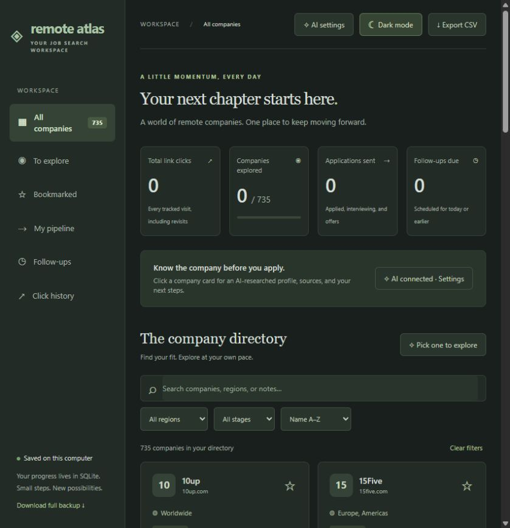
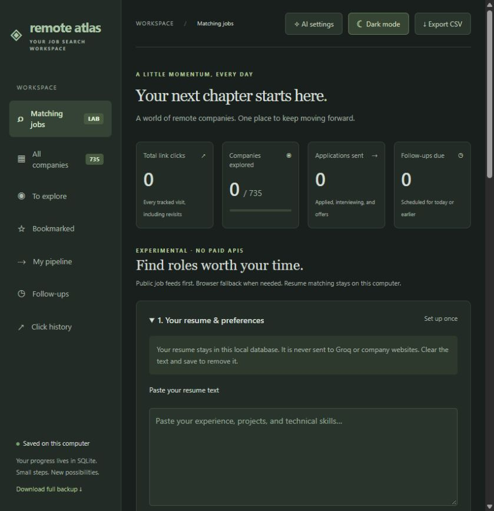

# Remote Atlas

A local workspace for a more focused remote-job search: explore companies, track applications, research employers, and find openings that overlap with your resume.

**735 companies · SQLite storage · Optional Groq research · Local job matching · Dark mode**



## What the project does

| Feature | What you can do |
| --- | --- |
| Company directory | Browse 735 companies imported from the supplied 25-page PDF, with original website URLs, hiring regions, and source-page references. |
| Search and filters | Search company names, regions, and your notes; filter by region and application stage; sort by name, visits, recent activity, or follow-up date. |
| Click tracking | Count every tracked visit and see how many distinct companies you have explored. Repeated visits count separately. |
| Shortlist | Bookmark interesting companies, revisit unexplored companies, or pick a random unexplored company from your current selection. |
| Application notebook | Save application stages, personal notes, and follow-up dates for each company. |
| Dashboard | See total clicks, unique companies explored, applications sent, and follow-ups due. |
| Click history | Browse the latest 200 tracked visits; the full history remains in SQLite. |
| AI company profiles | Optionally research company summaries, industry, size, headquarters, founding year, remote policy, hiring regions, tech stack, hiring activity, and careers links using Groq. |
| Research controls | Turn AI fetching on or off, refresh a profile, and reopen cached research without another AI request. |
| Matching jobs **(experimental)** | Collect public openings, compare recognized skills with your resume locally, and filter jobs and companies into a shortlist. |
| Scan automation | Run bounded background scans, stop a scan, reuse cached checks, or enable daily scans while the app runs. |
| Exports | Export company tracking data to CSV or JSON, including AI profiles and full click history in JSON. |
| Appearance | Use a muted dark theme or switch to light mode; the browser remembers your choice. |
| Shared demo | Let a friend try a separate demo database without exposing your personal progress, resume, or Groq settings. |

The source PDF is titled **640 remote first companies**, but its actual company table contains **735 entries**. Wrapped URLs are joined during import, one blank region is labeled **Not specified**, and the final recruitment-adviser promotional link is excluded. The source PDF itself is not included in this repository.

## Quick start

Requires Python. The core tracker uses only Python's standard library; the scanner has optional dependencies described below. Development was tested on Windows with Python 3.14.

```powershell
git clone https://github.com/Shahid0324-GIT/remote_atlas.git
cd remote_atlas
python app.py --open-browser
```

Or double-click **Start Remote Atlas.cmd** on Windows.

Open [http://127.0.0.1:8000](http://127.0.0.1:8000). Keep the terminal open while using the app; press **Ctrl+C** to stop. Your saved progress survives restarts.

Use another port if needed:

```powershell
python app.py --port 8001
```

### Choose a workspace

| Mode | How to start | Default URL for this command | Database |
| --- | --- | --- | --- |
| Personal tracker | `python app.py --open-browser` | `http://127.0.0.1:8000` | `data/tracker.sqlite3` |
| Scanner experiment | **Start Job Scanner.cmd** after setup | `http://127.0.0.1:8003` | `data/scanner-experiment.sqlite3` |
| Shared demo | `python app.py --demo --port 8002` | `http://127.0.0.1:8002` | `data/demo.sqlite3` |

Each workspace has its own progress. The experimental launcher does **not** copy or change your personal tracker database, and starts Groq research disabled. The scanner feature is also available when running the regular tracker with the required optional dependencies.

## Everyday tracking

1. Search or filter the directory and bookmark companies that interest you.
2. Click a company card to open **Company profile**, or choose **Notes & tracking** to go straight to the private notebook.
3. Set a stage: **Not started**, **Researching**, **Applied**, **Interviewing**, **Offer**, or **Closed**.
4. Add notes and a follow-up date, then save.
5. Use the sidebar to revisit your bookmarks, pipeline, due follow-ups, or click history.

**Counting rules:** Open website, researched careers-page buttons, scanner careers buttons, and View job record company visits. Scan requests and merely opening a company profile do not count as clicks. Source-citation links and websites opened outside the app are not tracked. A tracked click records the attempt to open a URL, even if that destination fails to load.

**Dashboard rules:** Applications sent counts companies currently marked Applied, Interviewing, or Offer. Pipeline includes every stage except Not started. Follow-ups are due on the selected date or earlier, using your browser's local date. Follow-up dates are in-app reminders; there are no email, desktop, or background notifications.

## Optional AI company research

The directory and scanner work without a Groq key. AI company research is a separate, optional feature and may incur API charges or hit your account's quotas.

### Connect Groq

1. Open **AI settings** in the header.
2. Enter a Groq API key and select a model: `openai/gpt-oss-20b` or `openai/gpt-oss-120b`.
3. Save the connection and enable **AI research** in the directory banner.
4. Open an uncached company profile to research it, or use **Refresh details** to update saved research.

Alternatively, copy `.env.example` to `.env` and fill it in locally:

```dotenv
GROQ_API_KEY=replace_with_your_groq_key
GROQ_MODEL=openai/gpt-oss-20b
```

Nonempty `.env` values take precedence over environment variables. Settings are read for each request; changing the key does not require restarting the app. Never commit or share a real key. The `.env` file is Git-ignored and credentials are excluded from exports; someone with access to your local files can still read it.

### What happens during research

- Groq receives the public company name and website URL, then uses browser search for evidence.
- A second request extracts a structured profile. Only recognized source URLs from that research are retained for displayed citations.
- Results, sources, and a last-researched timestamp are cached in SQLite.
- Missing sourced details show **Not found**. Failed refreshes preserve the previous profile.
- At most two company research requests run simultaneously. First-time research can take 30–90 seconds or longer.
- Your personal notes, application history, resume, and click history are not sent to Groq.

The **AI research** switch blocks new research and manual refreshes on the server. Saved profiles and tracking stay available. This preference persists in SQLite. A request already sent to Groq may finish after you switch research off. The app reports missing keys, connection problems, access restrictions, and rate limits.

## Experimental job scanner and resume matching

This feature is being evaluated separately on `feature/local-job-matching`. It can be used without paid APIs and does **not** call Groq, regardless of the AI research switch.



### One-time setup on Windows

Double-click **Setup Job Scanner.cmd**. It:

- Creates the project-local `.venv-scanner` environment.
- Installs the pinned Playwright and pypdf dependencies from `requirements-scanner.txt`.
- Downloads headless Chromium into the ignored `.local-tools/pw-browsers` folder.

Then double-click **Start Job Scanner.cmd**, or run:

```powershell
.\.venv-scanner\Scripts\python.exe app.py --scanner-experiment --port 8003 --open-browser
```

Public feeds and regular HTML extraction can work without Playwright. Leave browser fallback unchecked if you have not installed it. PDF import needs pypdf; pasting resume text avoids that dependency.

### From resume to shortlist

1. Open **Matching jobs (LAB)**.
2. Paste your resume or import a text-based PDF / `.txt` file. Review the extracted text, then **Save & match locally**. PDF imports support files under 4 MB and at most 10 pages; encrypted or image-only PDFs need pasted text. Only extracted text is stored, not the original file.
3. Set role-title keywords, preferred country/location, and optional professional experience.
4. Choose bookmarked companies or all companies, and a batch of 25, 100, or all companies in scope. Start small while evaluating coverage.
5. Click **Scan now**. The queue runs in the background and shows progress, cached checks, and failures. **Stop scan** stops between network operations.
6. Adjust the skill-overlap threshold and filter by explicit remote status, listed location, detected experience mismatches, or jobs without a score.
7. Switch to **Company coverage** to filter companies with matching jobs, checked feeds, partial coverage, failed checks, or no scan yet.
8. Open a job, check its requirements, or jump directly to your notes for that company.

Use **Connect or correct a company careers page** to save an actual careers or ATS board URL. **Save & scan this company** checks that company immediately. Verified starter sources for 15Five and Acquia are included; you can replace them. These sources are starting points, not a promise that suitable roles are currently open.

### Job sources and discovery

| Source | How it is used |
| --- | --- |
| Greenhouse | Public job-board API with job descriptions. |
| Lever | Public postings API, including global and EU boards. |
| Ashby | Public job-board API; unlisted postings are excluded. |
| Regular careers pages | JSON-LD `JobPosting` records and bounded HTML job-detail pages whose heading matches the observed job-title link. |
| Playwright fallback | Render JavaScript pages and try up to two visible Load more / Show more actions. |

Discovery starts from a manual careers override, an available researched careers URL, or the company's original website. Provider board names are taken from observed URLs rather than guessed from company names.

Website navigation respects robots.txt. Requests are paced and bounded by timeouts, response sizes, up to five discovery pages, three job-detail pages, and one browser session per company. Private-network destinations, embedded URL credentials, and unusual ports are rejected; redirects are checked too. A slow final request can overrun the nominal 65-second company budget.

### What a match score means

**Skill overlap = recognized posting skills found in the resume ÷ all recognized posting skills.**

Matching uses a local skill-alias dictionary and word boundaries. Each result shows matched skills, skills not found in the resume, and a job excerpt. It is an explainable keyword score, **not semantic AI assessment, a hiring probability, or proof that you meet all requirements**. Detected skills can include nice-to-haves as well as required skills.

Role-title keywords are evaluated separately. Seniority and detected years of experience produce warnings. Remote status and location come from the individual listing; missing evidence stays unknown. A remote company or the PDF's Worldwide label does not establish eligibility for a particular job or country.

Changing your saved resume or preferences rematches collected jobs locally without fetching websites again. The results endpoint evaluates up to 10,000 recent active postings and returns the top 3,000 title-matching jobs, with a visible warning if this limit is reached.

### Cache, freshness, and daily scans

- Successful and partial checks are cached for **24 hours**; failed checks for **4 hours**.
- Unchecked and oldest checks go first. **Refresh cached checks** forces another fetch.
- Changing a careers override invalidates its previous check.
- Failed refreshes keep older jobs, clearly marked for verification.
- A complete public feed can deactivate jobs that disappeared. Partial HTML scans do not claim exhaustive coverage or silently remove all previous listings.
- Optional daily scanning checks once a minute while the app runs, and starts when the previous scan began at least 24 hours ago, or on the first tick if no scan exists.
- Daily scanning is initially off. It does not run when the app is closed or wake a sleeping computer.
- Interrupted scans are marked interrupted on restart rather than silently continuing the crawl.

### Coverage limitations

A public feed with no matching roles, a partially readable careers page, and a blocked site are different outcomes. The app preserves that distinction. Some companies have outdated URLs, custom ATS platforms, unsupported layouts, login walls, or restrictions that require manual checking. Infinite scrolling and every site's pagination are not supported. The scanner never signs in, solves CAPTCHAs, or submits applications.

Live checks have verified the three supported feed types; all 735 companies have **not** been verified. Check the original listing before applying.

## Data, privacy, and backups

The server binds to `127.0.0.1` for personal local use. Resume text is used only for local matching and is not sent to Groq or company websites. Scanning sends ordinary requests for public company/job data.

| Data | Location / export behavior |
| --- | --- |
| Personal company tracking | `data/tracker.sqlite3` |
| Separate scanner experiment | `data/scanner-experiment.sqlite3` |
| Shared demo | `data/demo.sqlite3` |
| Groq key and model | Local, Git-ignored `.env`, or environment variables |
| Company seed data | Tracked `data/companies.json` |
| Starter careers sources | Tracked `data/careers-sources.json` |
| Dependencies and session files | Ignored `.venv-scanner/`, `.local-tools/`, and `.share/` |

New company seed entries are added at startup without overwriting existing tracking notes. The `REMOTE_ATLAS_DB` environment variable can select a custom database for a normal run; `--demo` and `--scanner-experiment` explicitly select their separate databases.

**CSV export** includes companies and tracking fields, with protection against spreadsheet formula execution. **JSON export** includes companies, full click history, and saved AI profiles. These exports do **not** contain the Groq key or the scanner's resume, preferences, jobs, or scan history. JSON import is not implemented.

For a complete backup, **stop the relevant app and copy its SQLite database**. To restore it, stop the app and replace that workspace's database with the backup. Do not copy a live SQLite database as a backup or upload it to Git. Resume text can be removed by disabling daily scanning, clearing the resume field, and saving.

## Share a temporary demo

Run a separate demo:

```powershell
python app.py --demo --port 8002
```

Use a temporary Cloudflare Tunnel pointing to `http://127.0.0.1:8002` to share it over the internet. Keep the computer awake and connected. Anyone with the generated URL can use the demo and see other demo visitors' edits; do not enter private notes there.

Demo mode disables Groq research, key settings, job-scanning APIs, and resume access on the server. It uses its own database and does not copy your personal data.

For a sharing session started by Codex and recorded in `.share/processes.json`, **Stop Demo Sharing.cmd** stops the recorded tunnel and demo process while leaving the personal tracker alone. It is not a general-purpose stop command for manually started processes. Quick-tunnel URLs change when a new tunnel is created; there is no permanent hosted deployment in this repository.

## Project structure

```text
app.py                         Local HTTP server, tracking API, SQLite setup
ai_profiles.py                 Groq configuration, sourced company research
job_sources.py                 Public feeds, page discovery, Playwright fallback
job_matching.py                Local skill extraction and scoring
job_scanner.py                 Background queue, cache, results, daily scheduling
static/                        Browser UI, themes, profiles, matching views
data/companies.json            Company catalog imported from the PDF
data/careers-sources.json       Verified starter career-board URLs
scripts/import_pdf.py          Optional catalog regeneration
scripts/stop_demo.ps1           Stop a recorded demo-sharing session
tests/                         Tracking, AI, scanner, and browser tests
requirements-scanner.txt       Optional scanner dependencies
```

The frontend uses vanilla HTML, CSS, JavaScript, and system fonts. There is no frontend build step. Node.js is only needed for the optional JavaScript syntax checks below.

## Development and verification

With the scanner environment installed:

```powershell
.\.venv-scanner\Scripts\python.exe -m unittest discover -s tests -v
node --check static/app.js
node --check static/profile.js
node --check static/matcher.js
```

The implementation passed **26 tests**, including feed parsing, local matching, cache invalidation, cancellation, source changes, stale results, private-network rejection, demo privacy, tracked job visits, and a real headless Chromium fixture that renders jobs through JavaScript and a Load more button. Tests use temporary databases; they do not alter personal progress. The browser test requires the optional Playwright package and installed Chromium.

The scanner is on `feature/local-job-matching` until reviewed and merged. To stop using the separate experiment, press Ctrl+C in its terminal and launch the normal tracker. To discard the feature branch, stop its server before switching branches; the original tracker database remains independent.

### Rebuild the company catalog

Only PDF re-extraction requires pdfplumber:

```powershell
python -m pip install pdfplumber
python scripts/import_pdf.py "C:\path\to\640 remote first companies.pdf"
```

The importer reads table data as content; it does not execute instructions from the PDF. Company links and hiring regions remain source material and may have changed since the document was compiled.
